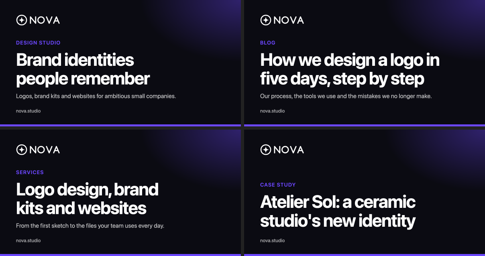
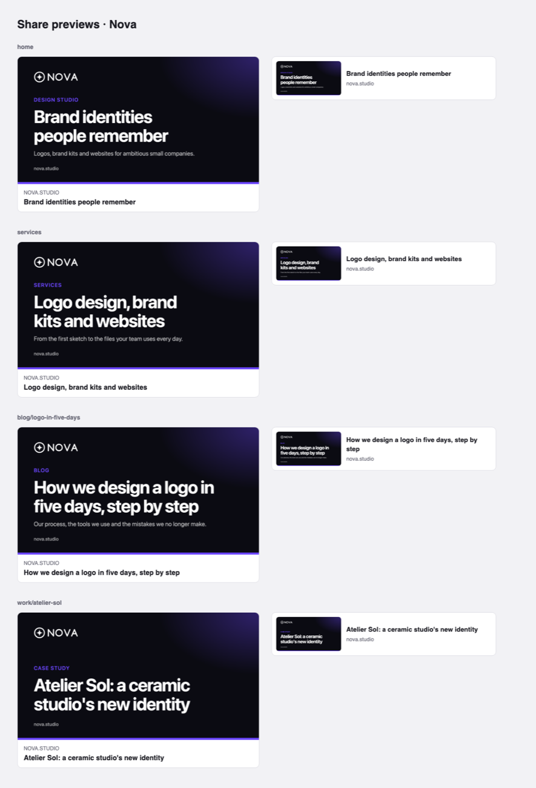

# og-kit

**Une image de partage pour chaque page de ton site, puis la vérification que chaque aperçu de lien fonctionne.**
Un [Agent Skill](https://agentskills.io) pour Claude Code, Codex, Cursor et tout agent IA qui lit les `SKILL.md`, et un script Python que tu peux aussi lancer toi-même.

🇬🇧 [Read in English](README.md)



Quand quelqu'un partage un lien sur LinkedIn, X, WhatsApp, Slack ou iMessage, l'app affiche une carte d'aperçu : une image, un titre, une description. L'image vient de la balise `og:image` de la page. La plupart des sites n'en ont pas, donc le lien s'affiche nu, ou ils réutilisent le même logo sur toutes les pages.

**og-kit règle ça d'un coup.** Ton agent lit le site (pages, titres, couleurs, logo, police), et le script dessine une image 1200×630 par page, aux couleurs de ta marque. L'agent branche ensuite les images dans le site et vérifie les balises de chaque page.

- **À tes couleurs :** tes couleurs, ton logo, ta police. La couleur du texte est choisie pour le contraste, et les titres longs rétrécissent pour tenir en 3 lignes.
- **Vérifié à l'œil :** une planche montre chaque image en grande carte de lien et en petite vignette, pour repérer une carte illisible avant que quelqu'un la partage.
- **Vérifié par le script :** balises manquantes, image en adresse relative, image inaccessible, mauvaise taille, image trop lourde, sur un site construit ou en ligne.
- **Branchement natif :** sur Next.js, les images deviennent des fichiers `opengraph-image.png` et le framework écrit les balises lui-même. Ailleurs, l'agent ajoute les balises.



## Installation

### Le plus simple : demande à ton agent

Colle ceci dans Claude Code, Codex, Cursor ou n'importe quel agent :

```text
Installe le skill https://github.com/Lvni7/og-kit
```

### Avec la CLI skills (plus de 40 agents)

```bash
npx skills add Lvni7/og-kit -g
```

### À la main

```bash
# Claude Code
git clone https://github.com/Lvni7/og-kit ~/.claude/skills/og-kit
# Codex
git clone https://github.com/Lvni7/og-kit ~/.codex/skills/og-kit
```

Puis vérifie que tout marche : `python3 ~/.claude/skills/og-kit/og_kit.py --test` affiche `ok`.

## Utilisation

Demande à ton agent, avec tes mots :

> Mes liens n'ont pas d'image quand je les partage. Fais les images de partage de toutes les pages du site.

Ou utilise le script toi-même. Décris le site et ses pages dans un petit fichier JSON :

```json
{
  "site": { "name": "Nova", "domain": "nova.studio", "logo": "logo-white.svg",
            "background": "#0b0b12", "accent": "#6C47FF" },
  "pages": [
    { "file": "home", "label": "Design studio", "title": "Brand identities people remember",
      "description": "Logos, brand kits and websites for ambitious small companies." },
    { "file": "blog/logo-in-five-days", "label": "Blog", "title": "How we design a logo in five days, step by step" }
  ]
}
```

```bash
python3 og_kit.py render og.json --out og-images     # un PNG par page + preview.png
```

| Clé | Rôle | Obligatoire |
|---|---|---|
| `site.name` | Nom de la marque, écrit quand il n'y a pas de logo | |
| `site.domain` | Affiché en bas de chaque image | |
| `site.logo` | SVG ou PNG, chemin relatif au fichier JSON | |
| `site.background`, `site.accent` | Couleurs de fond et d'accent | |
| `site.text` | Couleur du texte (par défaut : blanc ou noir, le plus lisible) | |
| `site.font` / `site.font_file` | Une police installée sur la machine, ou un fichier `.woff2` / `.ttf` | |
| `pages[].file` | Chemin du PNG, sans `.png` | ✓ |
| `pages[].title` | Le grand titre | ✓ |
| `pages[].label`, `pages[].description` | Petite étiquette au-dessus du titre, une ou deux lignes en dessous | |

Essaie-le sur le site d'exemple du dépôt :

```bash
python3 og_kit.py render examples/nova/og.json --out og-images
```

### Vérifier un site

```bash
python3 og_kit.py check out/                               # un site statique construit
python3 og_kit.py check https://exemple.fr/sitemap.xml     # toutes les pages d'un site en ligne
python3 og_kit.py check https://exemple.fr/tarifs          # une page
```

La commande se termine avec le code 1 s'il y a une erreur : elle peut aussi tourner en CI.

## Prérequis

- **Python 3.9+**, aucun paquet à installer.
- **Google Chrome**, Chromium ou Microsoft Edge. S'il est installé ailleurs que d'habitude : `CHROME=/chemin/vers/chrome python3 og_kit.py …`

## Comment ça marche

Chaque image est une page HTML rendue par Chrome sans interface à exactement 1200×630, 8 à la fois. Un petit script dans la page réduit le titre jusqu'à ce qu'il tienne en 3 lignes, une fois les polices chargées.
La planche d'aperçu est rendue de la même façon.
`check` lit le `<head>` de chaque page, récupère son `og:image` (dans le dossier pour un site construit, sur le web sinon), et lit la taille de l'image dans son en-tête : PNG, JPEG, GIF ou WebP.

Va bien avec [logo-kit](https://github.com/Lvni7/logo-kit), qui fait les versions claire et sombre d'un logo.

## Licence

[MIT](LICENSE) © Lvni7
