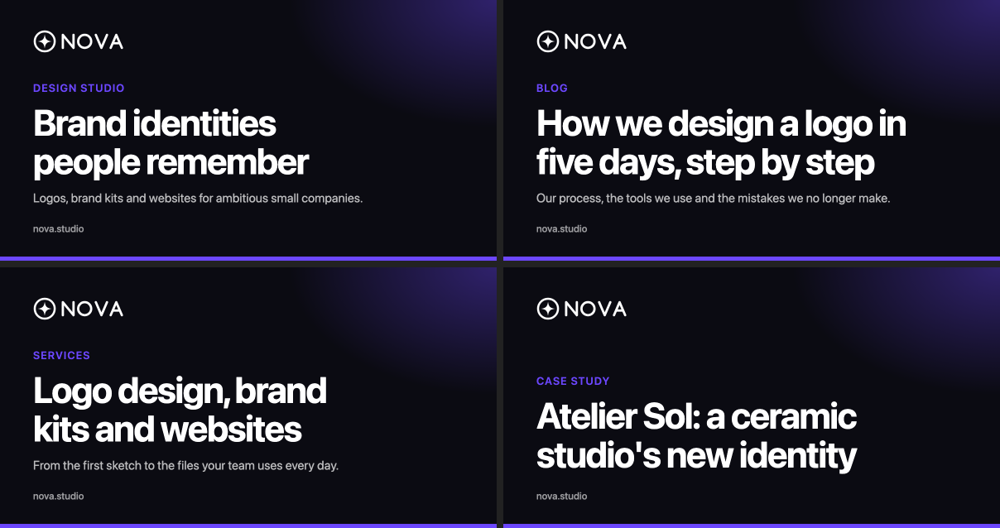
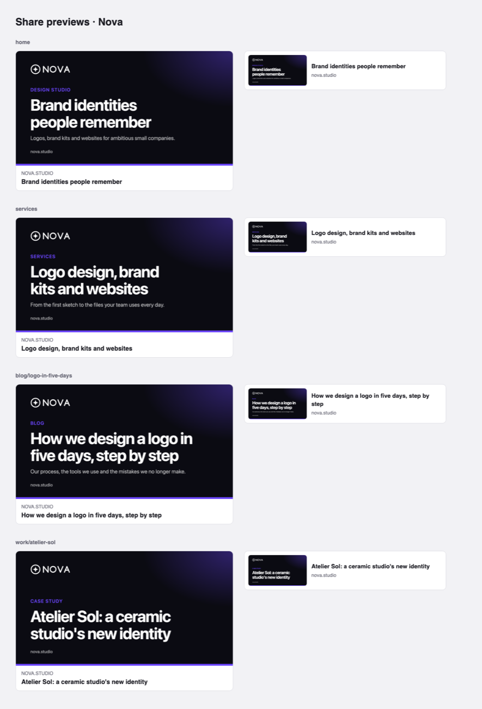

# og-kit

**Give every page of your website its own share image, then check that every link preview works.**
An [Agent Skill](https://agentskills.io) for Claude Code, Codex, Cursor and any AI agent that reads `SKILL.md`, plus a plain Python script you can run yourself.

[](LICENSE)


🇫🇷 [Lire en français](README.fr.md)



When someone shares a link on LinkedIn, X, WhatsApp, Slack or iMessage, the app shows a preview card: a picture, a title, a description. The picture comes from the page's `og:image` tag. Most sites have none, so the link shows up bare, or they reuse one logo for every page.

**og-kit fixes that in one go.** Your agent reads the site (pages, titles, colors, logo, font), and the script draws one 1200×630 image per page in your brand's style. The agent then wires the images into the site and checks the tags of every page.

- **On brand:** your colors, your logo, your font. The text color is picked for contrast, and long titles shrink to fit in 3 lines.
- **Checked by eye:** a preview sheet shows each image as a large link card and as a small thumbnail, so an unreadable card is caught before anyone shares it.
- **Checked by the script:** the missing tags, relative image URLs, unreachable images, wrong sizes and images that are too heavy, on a built site or a live one.
- **Native wiring:** on Next.js the images become `opengraph-image.png` files, and the framework writes the tags. Anywhere else, the agent adds the meta tags.



## Install

### The easy way: ask your agent

Paste this to Claude Code, Codex, Cursor or any coding agent:

```text
Install the agent skill from https://github.com/Lvni7/og-kit
```

### With the skills CLI (40+ agents)

```bash
npx skills add Lvni7/og-kit -g
```

### By hand

```bash
# Claude Code
git clone https://github.com/Lvni7/og-kit ~/.claude/skills/og-kit
# Codex
git clone https://github.com/Lvni7/og-kit ~/.codex/skills/og-kit
```

Then check that it works: `python3 ~/.claude/skills/og-kit/og_kit.py --test` prints `ok`.

## Use it

Ask your agent, in your own words:

> My links have no preview image when I share them. Make share images for every page of the site.

Or use the script yourself. Describe the site and its pages in a small JSON file:

```json
{
  "site": { "name": "Nova", "domain": "nova.studio", "logo": "logo-white.svg",
            "background": "#0b0b12", "accent": "#6C47FF" },
  "pages": [
    { "file": "home", "label": "Design studio", "title": "Brand identities people remember",
      "description": "Logos, brand kits and websites for ambitious small companies." },
    { "file": "blog/logo-in-five-days", "label": "Blog", "title": "How we design a logo in five days, step by step" }
  ]
}
```

```bash
python3 og_kit.py render og.json --out og-images     # one PNG per page + preview.png
```

| Key | What it does | Required |
|---|---|---|
| `site.name` | Brand name, written when there is no logo | |
| `site.domain` | Shown at the bottom of every image | |
| `site.logo` | SVG or PNG, relative to the JSON file | |
| `site.background`, `site.accent` | Background and accent colors | |
| `site.text` | Text color (default: white or black, whichever reads best) | |
| `site.font` / `site.font_file` | A font installed on the machine, or a `.woff2` / `.ttf` file | |
| `pages[].file` | Path of the PNG, without `.png` | ✓ |
| `pages[].title` | The big title | ✓ |
| `pages[].label`, `pages[].description` | Small label above the title, one or two lines under it | |

Try it on the sample site in this repository:

```bash
python3 og_kit.py render examples/nova/og.json --out og-images
```

### Check a site

```bash
python3 og_kit.py check out/                               # a built static site
python3 og_kit.py check https://example.com/sitemap.xml    # every page of a live site
python3 og_kit.py check https://example.com/pricing        # one page
```

```text
✗ blog/post.html
    warn: missing og:url
    warn: twitter:card is not summary_large_image: X shows a small card
    error: og:image must be an absolute URL: /og/post.png
✓ index.html
✗ services.html
    error: missing og:title
    error: missing og:description
    error: missing og:image
    warn: missing og:url
    warn: twitter:card is not summary_large_image: X shows a small card

3 page(s), 4 error(s)
```

It exits with code 1 when there is an error, so it can run in CI too.

## Requirements

- **Python 3.9+**, no package to install.
- **Google Chrome**, Chromium or Microsoft Edge. If it is installed somewhere unusual: `CHROME=/path/to/chrome python3 og_kit.py …`

## How it works

Each image is an HTML page rendered by headless Chrome at exactly 1200×630, 8 at a time. A small script in the page shrinks the title until it holds in 3 lines once the fonts are loaded.
The preview sheet is rendered the same way.
`check` reads each page's `<head>`, fetches its `og:image` (from the folder for a built site, from the web otherwise), and reads the image's size from its header: PNG, JPEG, GIF or WebP.

Pairs well with [logo-kit](https://github.com/Lvni7/logo-kit), which makes the light and dark versions of a logo.

## For AI agents

If a user gives you this repository's link and asks you to install it:

1. Find your skills folder: `~/.claude/skills` for Claude Code, `~/.codex/skills` for Codex, otherwise the folder where your agent loads `SKILL.md` skills from (`~/.agents/skills` for many).
2. Run `git clone https://github.com/Lvni7/og-kit <skills folder>/og-kit`, or `npx skills add Lvni7/og-kit -g -y`.
3. Run `python3 <skills folder>/og-kit/og_kit.py --test` and check that it prints `ok`.
4. Check that Chrome, Chromium or Edge is installed.
5. Tell the user the skill is ready, and that they can ask for "share images for every page of my site".

To use the skill, read [`SKILL.md`](SKILL.md): it holds the steps, the spec format, the wiring for Next.js and other sites, and the checks.

## License

[MIT](LICENSE) © Lvni7
